# 电气连接与上电顺序（飞特 HD-1910 版，第一版）

> **状态：第一版，尚未实测。** 接口定义来自上游原理图与文档，板卡型号来自 2026-11 到货实物丝印，整机还没通过电。实测后把文末「待实测 / 待确认」逐项改成结论，发现错的直接改。配置清单、采购信息和装机进度在 [复现记录](README.md)。

## 到货核对

按实物丝印 / 标签核对，2026-11 收货：

| 类别 | 实物 | 对应上游设计 | 备注 |
|---|---|---|---|
| HAT 扩展板 | 丝印 `elec_RPI_Robot_HAT ASE01187-D1`，Pollen Robotics | [pollen-robotics/elec_RPI_Robot_HAT](https://github.com/pollen-robotics/elec_RPI_Robot_HAT) D1 版 | 40 针排母未焊，需自配 2×20 排母；板载 LSM6DSV16X、麦克风、音频 codec，复刻软件不用它们 |
| Hub 分线板 | 丝印 `dxl_hub 0.2 26/10/9`，板上 1000 µF/10 V 电容 | [Scienceche/microduck-community-kit](https://github.com/Scienceche/microduck-community-kit) `hardware/dxl_hub` | 照片判断：正面 1 个 2.5 mm EH 口 + 2 个 2.0 mm 口，背面 1 个 2.0 mm 口，待清点 |
| 电池转接板 | 丝印 `banana_pcb 0.2 26/9/27`，两只香蕉头，红黑线已焊到 hub | 同上 `hardware/banana_pcb` | 和 hub 一起按「hub 分线板」发货 |
| IMU 姿态模块 | 丝印 `IMU_TO_DXL V1.0A`：J1 2.0 mm 3P、J2 1.2 mm 3P、J3 6P 焊盘 | [fanhao375 新版 imu_to_dxl_1V0A](https://github.com/fanhao375/microduck-replica/blob/master/hardware/新版/README.md)，STM32G031 + LSM6DSV16X | 挂舵机总线的从机，ID 200，不走 I²C；固件版本待确认 |
| 舵机 | 标签 `HD1910M`，各带一根 2.0 mm 双头线 | 飞特 HD-1910-C001 | 命名不一致是同一款；官方尺寸图上每颗有两个插口 |
| 微雪舵机控制板 | Waveshare Bus Servo Adapter (A)，CH343 | — | 只用于标 ID / 台架 |
| ToF 模块 | 6 针排针分线板 | VL53L8CX（按套餐描述） | 芯片丝印待核对 |
| 电源适配器 | 随微雪板发货，DC 5.5×2.1 | — | **输出电压待核对标签**，见[供电](#供电与上电关机顺序) |
| 主控 | Radxa Zero 3W，排针已焊 | — | 板版本待核对背面丝印（2024-11 后出厂多为 V1.12） |
| 线材 | 1 根长 EH-EH 线、1 根两端插头不同的转接线、1 根短 2.0 线、1 对裸红黑硅胶线，见[线材照片](assets/photos/cables-annotated.jpg) | 套餐描述「AMP2.0 转接线 + EH 线」 | 各线两端插头规格待逐根核对 |

## 连接示意图

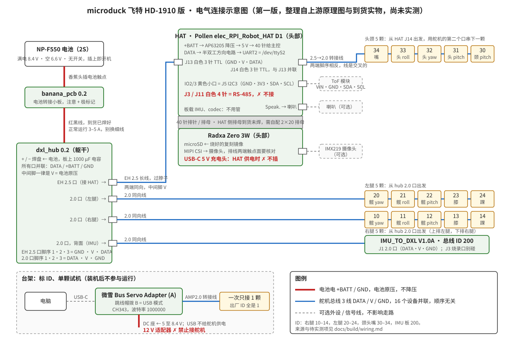

源文件 [assets/wiring.svg](assets/wiring.svg)，文本编辑器可改。按到货实物照片画的连接顺序见下一节。

## 实物连接顺序

照片是 2026-11 收货实拍，缩到 1400 px 存在 [assets/photos/](assets/photos/)；带 `-annotated` 后缀的是画了编号的版本，编号含义在每张照片底部的说明条里。总图里的步骤号和下面的小节一一对应。

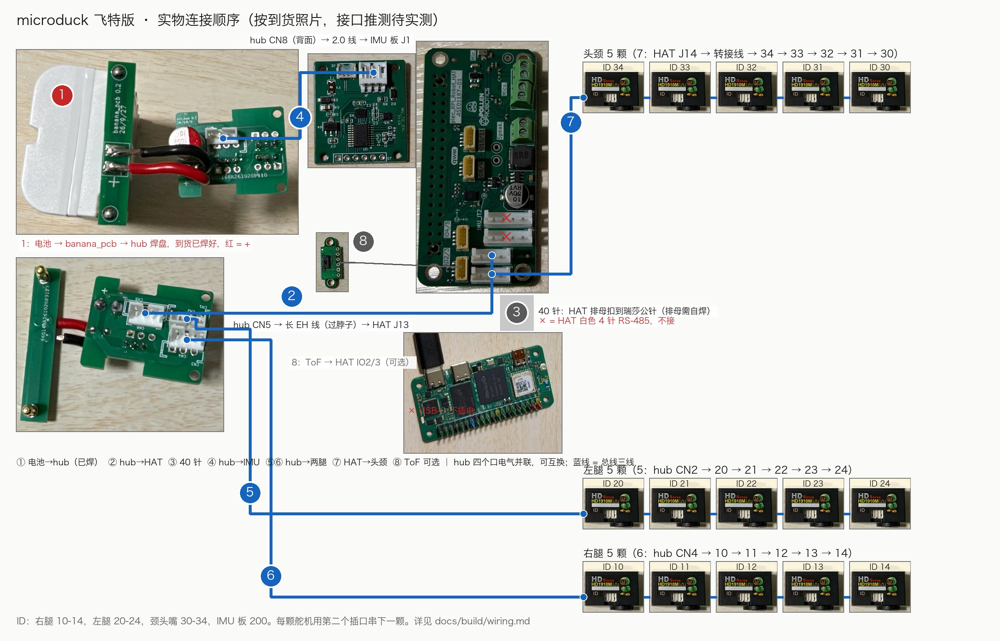

hub 四个口在电气上完全并联，下面写的「CN5 接 HAT、CN2 接左腿、CN4 接右腿、CN8 接 IMU」只是按插头规格给的建议分配，换着插也行。接口位号按原理图和照片上的丝印推断，装机时对一下板子上的丝印。

### 第 0 步 · 台架上先把 15 颗舵机标好 ID

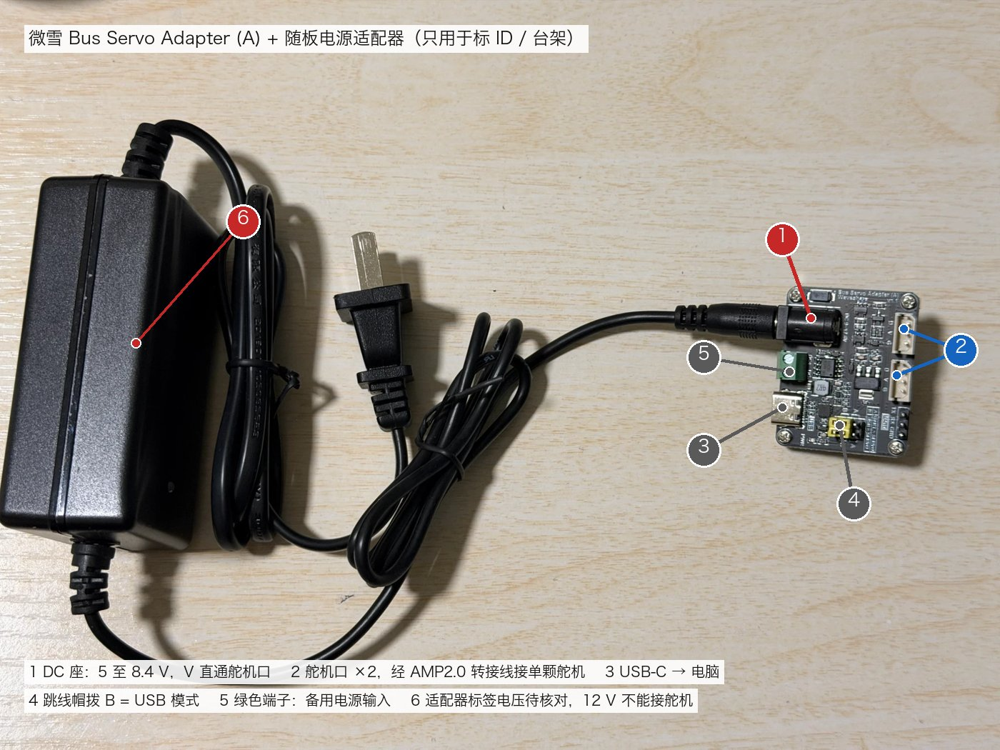

1. 跳线帽 4 拨到 B，USB-C 3 接电脑，装 CH343 驱动后设备管理器出现 COM 口。
2. DC 座 1 接 5 至 8.4 V 电源。**先看随板适配器 6 的标签**，12 V 不能用；只标 ID 的话一根 USB 转 DC5.5×2.1 线取 5 V 就够。
3. 一颗舵机经 AMP2.0 转接线插舵机口 2，FD 软件选 COM 口、波特率 1000000，搜到 ID 1 后改成目标 ID，打开过流、过压保护，保存。
4. 断电重插再搜一遍，看到新 ID 才算写进去；贴「关节名 + ID」标签，换下一颗。ID 表见上一节。

### 第 1 步 · 电池 → banana_pcb → hub

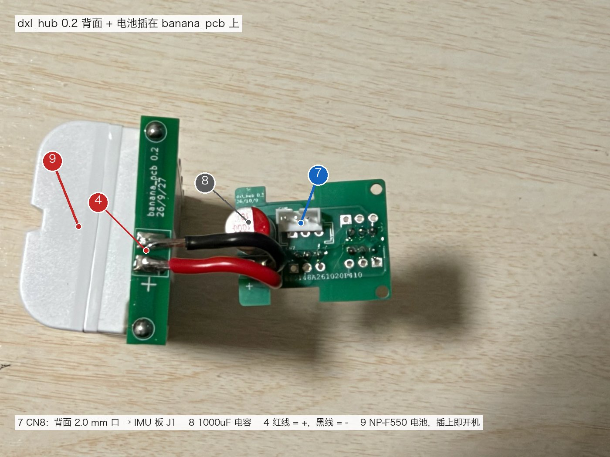

到货时 banana_pcb 的红黑线 4 已经焊到 hub 的 + / - 焊盘上，红线是 +。电池 9 直接插在 banana_pcb 的两只香蕉座上，插上即通电，所以这一步放到最后做：先把下面的线全插好，再插电池。装电池前用万用表量 hub 任一口的中间脚对 GND，应等于电池电压、极性正确。

### 第 2 步 · hub CN5 → 长 EH 线 → HAT J13

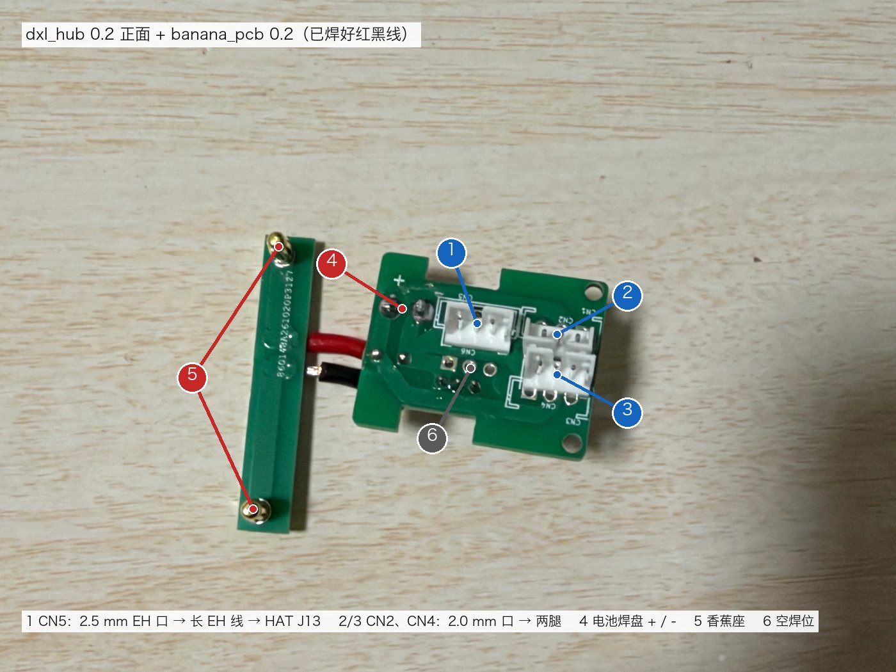

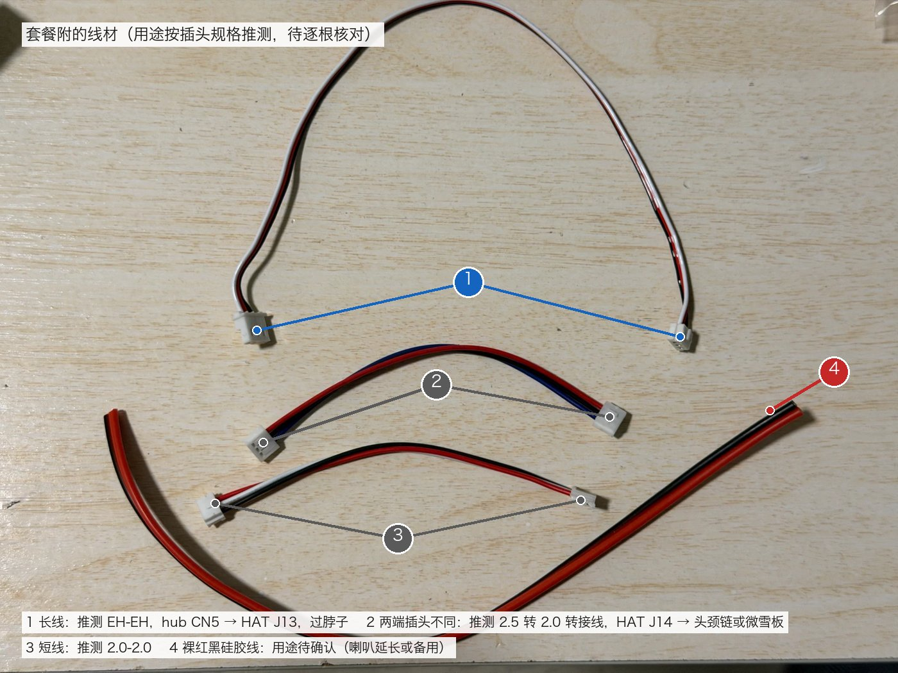

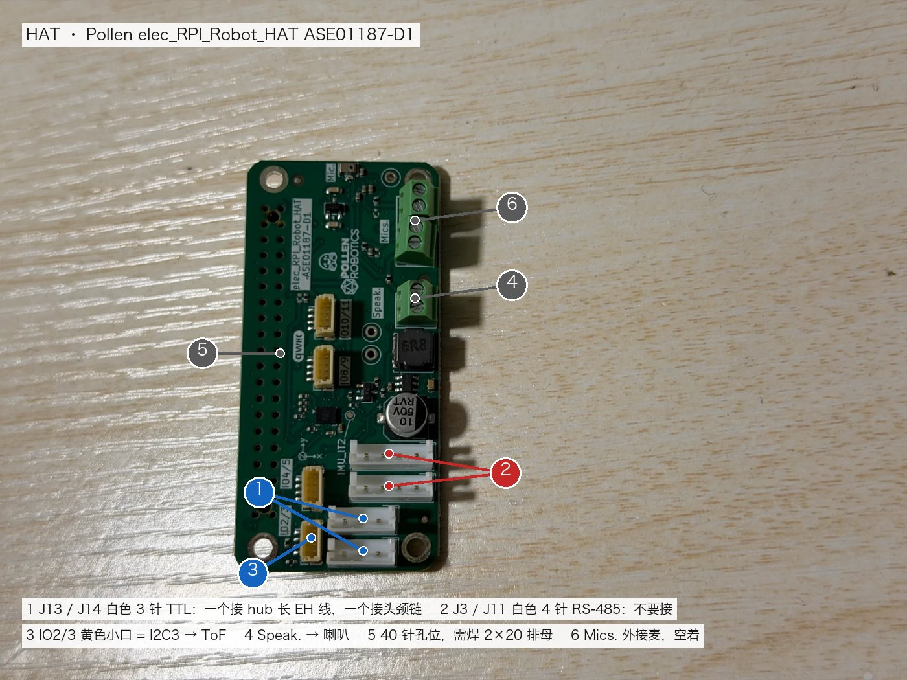

hub 正面那个大一号的白口 1 是 2.5 mm EH 口 CN5，脚序 GND · V · DATA，和 HAT 白色 3 针口 1 一样。用线材照片里最长的那根 1 把两者连起来，这根线装机时穿过脖子。两端同向，插之前量一下中间脚互通。HAT 两个白色 3 针口并联，插哪个都行；白色 4 针口 2 是 RS-485，不要插。

### 第 3 步 · HAT 叠到瑞莎上

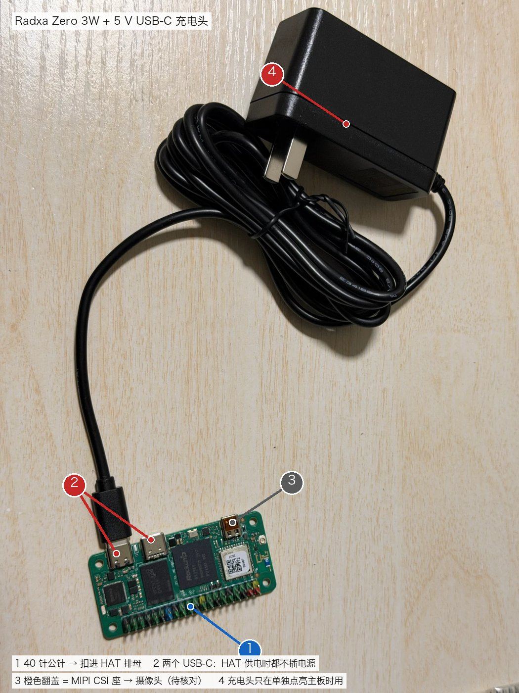

HAT 的 40 针孔位 5 到货没焊排母，先焊一个 2.54 mm 2×20 排母，再整体扣到瑞莎的 40 针公针 1 上。瑞莎的 5 V 就从这 40 针进来，所以 HAT 供电后两个 USB-C 2 都不要再插电源；充电头 4 只在没接 HAT、单独点亮主板时用。microSD 烧好复刻镜像插上；摄像头排线接 3，两端触点面要对准，可以最后装。

### 第 4 步 · hub CN8 → IMU 板 J1

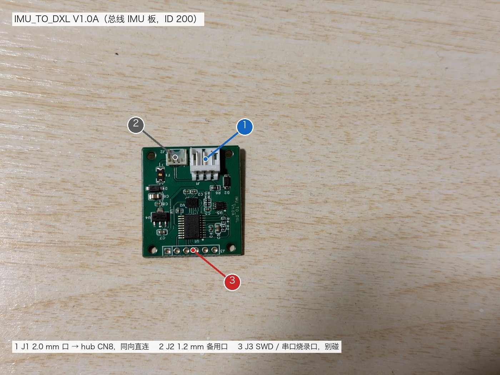

hub 背面的 2.0 mm 口 7 用一根 2.0-2.0 短线接到 IMU 板的 J1 1，两边脚序都是 DATA · V · GND，同向直连。J2 2 是 1.2 mm 备用口，J3 3 是烧录口，都不用动。IMU 板要在第一次开机前接好，镜像第一次开机会去总线上认 ID 200。

### 第 5、6 步 · hub CN2 / CN4 → 左腿 / 右腿

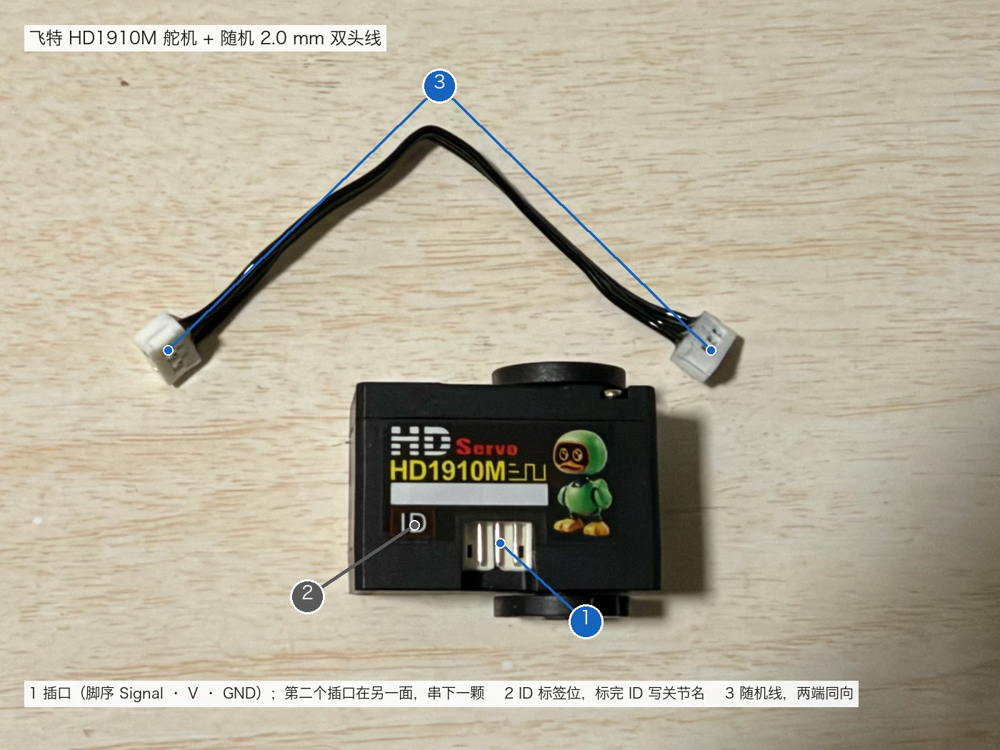

hub 正面右侧两个 2.0 mm 口 2、3 各出一根线，分别接左腿髋 yaw（ID 20）和右腿髋 yaw（ID 10）的插口 1。每颗舵机有两个插口，内部并联，用随机附的 2.0 mm 双头线 3 从第二个插口串到下一颗：20 → 21 → 22 → 23 → 24，10 → 11 → 12 → 13 → 14。顺序只是走线方便，电气上谁先谁后无所谓。

### 第 7 步 · HAT J14 → 转接线 → 头颈

HAT 另一个白色 3 针口接线材照片里两端插头不同的那根 2，另一头是 2.0 mm，接头颈链的第一颗。HAT 口脚序是 GND · V · DATA，舵机口是 Signal · V · GND，所以这根转接线应当是交叉的，插之前量一下：HAT 端脚 3 通到舵机端脚 1。链路 34 → 33 → 32 → 31 → 30，同样用舵机的第二个插口往下串。

### 第 8 步 · 可选外设

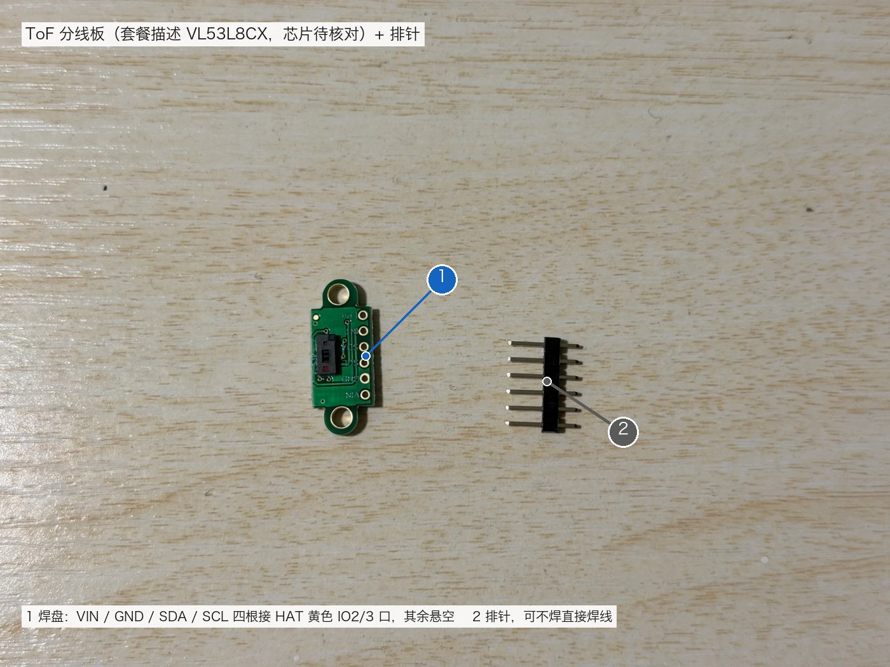

- ToF：焊盘 1 里的 VIN / GND / SDA / SCL 四根接 HAT 黄色 IO2/3 口 3，走 JST-SH 1.0 mm 四线，其余脚悬空。
- 喇叭：接 HAT 绿色 Speak. 端子 4，极性无所谓。
- 这两样和摄像头都不影响走路，可以等站起来以后再装。

### 第 9 步 · 上电

全部插好后插电池，等约 3 分钟，手机连热点 `Microduck-xxxx` 打开 Studio，按[第一次上电核对清单](#第一次上电核对清单)往下走。关机先在 Studio 或手柄上软关机，再拔电池。

## 链路怎么走

整机只有两种电气连接：

1. **电池电 +BATT / GND**：电池原压 6.6–8.4 V，不降压，直接喂舵机。
2. **舵机总线三线 DATA / V / GND**：V 就是电池原压。15 颗舵机加 IMU 板共 16 个设备**并联**在同一条总线上，谁接谁、先后顺序都不影响电气，只要每个设备三根线都通。菊花链只是走线方便。

```
NP-F550 电池 ─香蕉头→ banana_pcb ─红黑线→ dxl_hub 的 +/− 焊盘
                                           │  hub 上所有 3 针口并联：DATA / +BATT / GND
          ┌──────────────┬────────────────┼────────────────┐
     2.5 mm EH 口     2.0 mm 口        2.0 mm 口         2.0 mm 口
          │              │                │                │
     长 EH 线过脖子    左腿 20→21→22    右腿 10→11→12    IMU 板 J1
          │              →23→24           →13→14         （ID 200）
     HAT 白色 3 针口 J13
          │  HAT 内部：+BATT → AP63205 降压 → 5 V → 40 针 → 瑞莎
          │            DATA  → 半双工方向电路 → UART2 = /dev/ttyS2
     HAT 另一个白色 3 针口 J14 → 2.5→2.0 转接线 → 头颈 34→33→32→31→30
```

头颈那一串也可以不从 HAT 出，改挂 hub 的空焊位，电气上等价；本版按到货的四个口接法画。瑞莎不直接接电池，它的 5 V 由 HAT 把 +BATT 降压后经 40 针送入。

### 各口脚序

来自 dxl_hub 原理图、HAT 原理图和上游新版硬件说明：

| 板 / 口 | 脚 1 | 脚 2 | 脚 3 | 说明 |
|---|---|---|---|---|
| dxl_hub 2.5 mm EH 口 CN1/3/5/7 | GND | +BATT | DATA | Dynamixel 脚序，对 HAT |
| dxl_hub 2.0 mm 口 CN2/4/6/8 | DATA | +BATT | GND | 飞特脚序，对舵机和 IMU 板 |
| HD-1910 舵机口 | Signal | Vcc | GND | 两个口内部并联，第二个口串下一颗 |
| IMU 板 J1，2.0 mm | DATA | VDD | GND | 和 hub 2.0 口同向直连；J2 为 1.2 mm 备用口；J3 是 SWD/串口烧录口，别碰 |
| HAT J13 / J14，2.5 mm EH | GND | VDD | DATA | 既是总线口也是整板电源入口，两口并联 |

两种口脚序正好相反，所以 2.0 转 2.5 的转接线必须是交叉的，脚 1 对脚 3。不管哪根线，**中间脚一定是 V**，这一条对了就烧不了板；两边接反只是搜不到舵机，对调即可。

### HAT 上的接口

| HAT 丝印 | 位号 | 用途 |
|---|---|---|
| 两个白色 3 针 | J13 / J14 | TTL 总线，接 hub 和头颈舵机 |
| 两个白色 4 针，旁边 IMU_IT2 | J3 / J11 | RS-485，**不要插** |
| 黄色小口 IO2/3 | J5，I2C3 = 40 针 3/5 脚 | 接 ToF。JST-SH 1.0 mm 四线 GND / 3V3 / SDA / SCL 对模块 GND / VIN / SDA / SCL |
| 黄色小口 IO4/5、IO8/9、IO10/11 | J6–J8 | 空着 |
| 绿色端子 Speak. | J1 | 喇叭，极性无所谓 |
| 绿色端子 Mics. | J2 / J9 | 外接麦克风，空着，板上自带麦 |
| 40 针孔位 | J4 | 官方 BOM 为 2×20 母座，到货未焊；焊上后扣到瑞莎的公针上 |

摄像头走瑞莎自己的 MIPI 座，不经过 HAT；排线两端的触点面要对准，上游在这上面翻过车。摄像头和 ToF 都不影响走路，可以最后装。

## 微雪控制板标 ID

Waveshare Bus Servo Adapter (A) 只在电脑上给舵机标 ID 和单颗试机，装机后不参与运行。

接法：跳线帽拨到 **B** 即 USB 模式，Type-C 接电脑，舵机经 AMP2.0 转接线插白色舵机口。芯片是 CH343，Win10/11 免驱。软件用飞特 FD 或微雪的 STServo Python 示例，波特率 1000000。

| 注意 | 说明 |
|---|---|
| 舵机口的电来自 DC 座 | 原理图上舵机口三脚是 DATA / DC_IN0 / GND，V 脚直接等于 DC 座或绿色端子的输入电压，**USB 不给舵机供电** |
| 输入电压 5 至 8.4 V | 只标 ID 空载，一根 USB 转 DC5.5×2.1 线取 5 V 就够。这块板是给 12 V 舵机设计的，随板适配器很可能是 12 V；HD-1910 上限 8.4 V，**12 V 插上舵机就烧** |
| 一次只接一颗 | 15 颗出厂 ID 全是 1。改完断电重插再搜一遍确认写进了 EEPROM，贴「关节名 + ID」标签再换下一颗 |
| 顺手开保护 | 过流、过压保护打开；波特率、运行模式、中位别动 |

ID 表，来自上游 `duck-control/src/model.rs`：

| ID | 关节 | ID | 关节 | ID | 关节 |
|---|---|---|---|---|---|
| 10 | 右髋 yaw | 20 | 左髋 yaw | 30 | 颈俯仰 |
| 11 | 右髋 roll | 21 | 左髋 roll | 31 | 头俯仰 |
| 12 | 右髋 pitch | 22 | 左髋 pitch | 32 | 头 yaw |
| 13 | 右膝 | 23 | 左膝 | 33 | 头 roll |
| 14 | 右踝 | 24 | 左踝 | 34 | 嘴 |

十位是部位，个位从髋 yaw 数到踝；200 固定给 IMU 板。

微雪板另有两个备用价值：给 IMU 板升级固件时当电脑端的 USB 转 TTL；万一 HAT 出问题，跳线拨 A，用 UART 口飞线到瑞莎 8/10 脚可以顶替 HAT 的总线功能，但逻辑电只能接 3.3 V，见上游[不打 HAT](https://github.com/fanhao375/microduck-replica/blob/master/docs/不打HAT.md)。

## 供电与上电关机顺序

- 电池只有一条出路：香蕉头进 banana_pcb，红黑线进 hub，hub 分给四路。没有电源开关，插上电池就是开机。
- 运行期间**不要**再往瑞莎 USB-C 插 5 V 充电头。这批 V1.12 主板的 40 针 5 V 和 USB-C 供电是同一个网络，两路电并在一起有风险。USB-C 充电头只在没接 HAT、单独点亮主板时用。
- 关机走软件：手柄 Select 按住 2 秒，或网页「关机」，等关完再拔电池。直接拔电池伤 SD 卡。
- 满电 8.4 V 正好等于 HD-1910 上限，刚充满别做堵转测试。
- 上游走路时整机掉电重启的根因是供电冲击，电池到 hub 这段线别细、别长，hub 上的 1000 µF 电容就是为这个加的。
- 电源适配器如果要替代电池给 hub 供电，只能是 7.4–8.0 V 且电流足够的型号，并且只进 hub 的 +/− 焊盘，不能进瑞莎 USB-C。

## 第一次上电核对清单

先不装打印件，把电路在桌上摆开跑通，再装机：

1. 用微雪板把 15 颗 ID 标完、贴标签。
2. 电池插上 banana_pcb，万用表量 hub 的 + 和 − 焊盘：应有 7 至 8.4 V 且极性正确。再量每个口的中间脚对 GND，都应等于这个电压。
3. 每根线插之前量一遍：两端中间脚互通；EH 对 EH 的线同向，2.0 对 2.5 的转接线交叉。
4. 焊好 HAT 排母，HAT 扣上瑞莎，SD 卡烧上游复刻镜像插好。只接 hub 到 HAT 这一根线上电，等 3 分钟，手机连热点 `Microduck-xxxx`，密码 `microduck`，浏览器开 `http://10.42.0.1:8000/` 看到 Studio 就算主控活了。
5. 断电，把 IMU 板和舵机链路全插上，再上电。IMU 要在这次开机前接好，镜像第一次开机会去认它。Studio 舵机页应看到 15 颗全在线，IMU 页显示识别到 ID 200。
6. 照 Studio 的「上手清单」做零位校准、IMU 方向校准、写入主程序，然后站起来。详见上游[烧录和第一次使用](https://github.com/fanhao375/microduck-replica/blob/master/software/image/烧录和第一次使用.md)。

## 待实测 / 待确认

- [ ] 电源适配器标签电压；12 V 则不能接舵机
- [ ] 套餐是否附 2×20 排母；没有就自购
- [ ] 每根线两端插头规格与线序，按上表用万用表点一遍
- [ ] HD-1910 实物第二个插口的位置
- [ ] hub 四个口实际焊在哪些位号，和示意图、照片标注（CN5 / CN2 / CN4 / CN8）对一下
- [ ] HAT J13 中间脚实测为电池电压
- [ ] IMU 板固件版本，Studio IMU 页能否自动识别 ID 200
- [ ] ToF 分线板引脚丝印；若 4 线接上后 I²C 搜不到，再查 LPn 是否要上拉
- [ ] 瑞莎板版本丝印

## 来源

- [fanhao375 硬件入门](https://github.com/fanhao375/microduck-replica/blob/master/docs/硬件入门.md)、[硬件规格速查](https://github.com/fanhao375/microduck-replica/blob/master/docs/硬件规格速查.md)、[新版硬件说明](https://github.com/fanhao375/microduck-replica/blob/master/hardware/新版/README.md)、[调试记录 · 舵机配置](https://github.com/fanhao375/microduck-replica/blob/master/调试记录.md)、[踩坑记录](https://github.com/fanhao375/microduck-replica/blob/master/踩坑记录.md)
- [Scienceche/microduck-community-kit](https://github.com/Scienceche/microduck-community-kit)：dxl_hub / banana_pcb 的 KiCad 工程，脚序由 `dxl_hub.kicad_sch` 解析
- [pollen-robotics/elec_RPI_Robot_HAT](https://github.com/pollen-robotics/elec_RPI_Robot_HAT)：D1 原理图与 BOM
- [Waveshare Bus Servo Adapter (A) wiki](https://www.waveshare.com/wiki/Bus_Servo_Adapter_(A)) 及其原理图
- [FEETECH wiki · HD-1910-C001](https://ftservo.github.io/ftservo-wiki/en/products/models/hd-1910-c001/main/)
- [JieJie-H/microduck-servo-numbering](https://github.com/JieJie-H/microduck-servo-numbering)：标 ID 流程与 ID 表

[返回复现记录](README.md)
